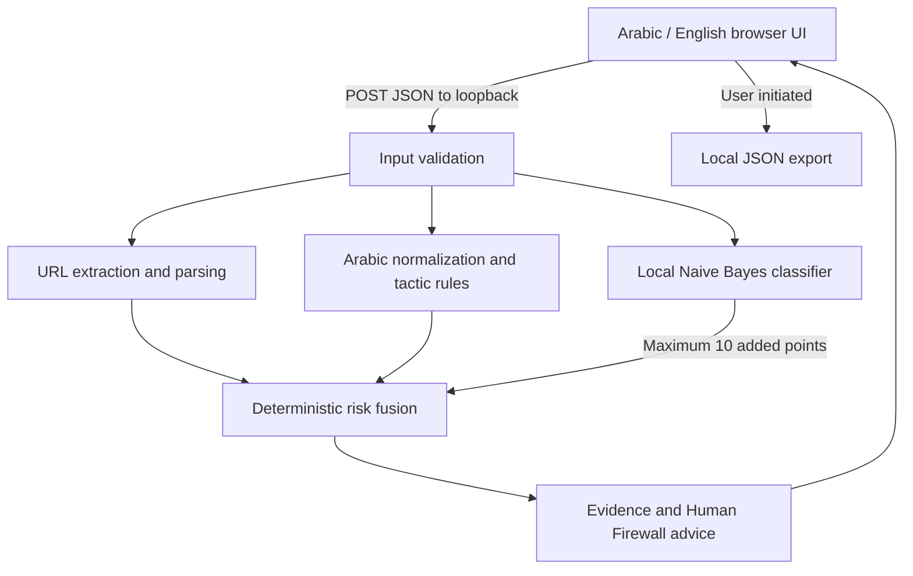

# Technical design v0.1

## Architecture



One process serves assets and the API at `127.0.0.1:4173`. No database, network calls to analyzed links, remote AI service or secrets. The model trains once in process memory from `data/training.json` when the engine loads.

## API

`GET /api/health` returns version, local mode and readiness. `POST /api/analyze` accepts `Content-Type: application/json` and `{ "text": "message or URL" }`. Success is HTTP 200 with the schema below. Validation errors return 400; excessive body size returns 413; wrong content type returns 415; unacceptable Host/Origin returns 403; unknown routes return 404. HTTP request timeout is 10 seconds. Input body limit is 50,000 bytes. Browser form submissions are not accepted.

```json
{
  "technicalScore": 55,
  "manipulationScore": 70,
  "finalScore": 79,
  "level": "high",
  "urls": [{"host":"adpolice.gov.ae.payment-review.example","score":55,"findings":[]}],
  "findings": [],
  "model": {"name":"Multinomial Naive Bayes","contribution":9},
  "coverage": {"urlsAnalyzed":1,"urlsOmitted":0,"fetched":false,"reputation":false,"domainAge":false}
}
```

The example is abbreviated; actual findings include `id`, `weight`, Arabic/English explanation and evidence. Evidence sentences use normalized Arabic. Use `technicalScore: null` for no extracted URL, never infer “safe.” Additional fields are `version`, `model.training`, `model.signal`, `model.knownTokens` and bilingual `disclaimer`.

## Technical engine

URLs are parsed with the WHATWG `URL` class. `www.` and standalone bare ASCII domains are supported. Only the first 20 distinct detected URLs are analyzed. No public-suffix parser or complete brand catalogue is included.

| Signal | Weight |
|---|---:|
| HTTP instead of HTTPS | 10 |
| Username/password section before @ | 35 |
| Numeric IPv4/IPv6 host | 25 |
| Punycode domain | 20 |
| Listed shortener | 15 |
| More than four hostname labels | 10 |
| Brand token or one-edit lookalike outside reference domain | 45 per brand |
| Invalid / unsupported URL | 25 |

Each URL index is capped at 100. The technical index is the maximum across URLs, so adding a low-risk link does not dilute a suspicious one. Brand references currently cover `adpolice.gov.ae`, `emiratesnbd.com`, `adcb.com`, `bankfab.com`. They are small manually supplied reference mappings, not a maintained verification service. Match boundaries require the exact domain or a dot-separated subdomain. Similarity is a bounded Levenshtein check for brand tokens longer than four characters. A reference match is never treated as proof of page or sender authenticity.

## Psychological engine

Arabic normalization removes diacritics/tatweel and normalizes common Alef/Ya forms. Distinct cues contribute once per message: urgency 20, threat/loss 25, authority claim 10, reward 20, secrecy 20, curiosity/embarrassment 15, credential request 35, payment request 15. Sum capped at 100. Explicit safety advice is suppressed at a sentence level. This is deliberately simple and can fail on mixed advice/attack text, quoted text, complex negation and dialects. Authority wording alone is not labeled confirmed impersonation.

## Fusion

Let T = technical index or 0 if missing; P = manipulation index; M = uncalibrated NB signal; K = known-token count.

```text
E = max(T, P)
C = round(max(0, M - 50) / 5) if E >= 15 and K >= 3 else 0
Final = min(100, E + C)
Limited signals: 0–29; review: 30–64; high signals: 65–100
```

The maximum prevents strong evidence from being averaged away. It also means two moderate independent scores may not cross the review threshold; S10 documents this limitation. Thresholds and weights are product heuristics, not statistically validated estimates. Never convert Final into “Scam probability.”

## Client behavior

All user-supplied text is inserted with `textContent`, not HTML. Results are invalidated when text changes. A revision counter rejects stale in-flight results. Switching language re-renders explanations without another request. Links appear as text and cannot be launched by the result UI. “AI Pause” is a visible checklist, not an extension or enforced countdown.

## Operational limits

Single-user demo only. Do not bind to a public interface or deploy the server directly. Hosted service work requires authentication, rate controls, audit design, abuse protections and a separate security review. Startup needs Node.js but not npm. Keep synthetic examples for the live demo. `docs/DELIVERY.md` defines the rehearsal and fallback.
